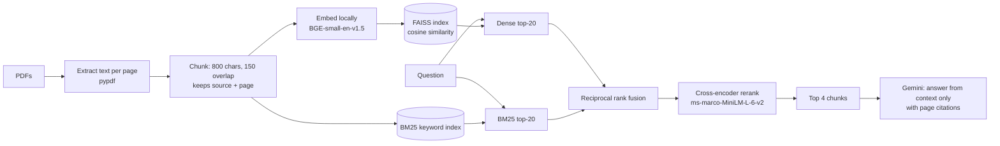

# Document Q&A over Indian Government PDFs (RAG with Measured Retrieval)

A retrieval-augmented question-answering system over three public Indian government PDFs. Answers are grounded in the documents and cite the source file and page. The retrieval pipeline was built step by step and evaluated on hand-labelled questions, with a held-out test set that was run once.

> Built as a portfolio project to learn how to build *and measure* a RAG system, not just wire one together.


## What it does

- Answers questions about the documents using only retrieved text, with citations like `[file.pdf, p.12]`.
- Replies "I could not find this in the documents." when the retrieved context does not contain the answer.
- Shows the retrieved chunks, source page and score in the UI so answers can be checked.

## Documents

| Document | Notes |
|---|---|
| NITI Aayog, National Strategy for Artificial Intelligence | narrative strategy document |
| Digital Personal Data Protection (DPDP) Act, 2023 | dense legal text |
| MeitY Annual Report 2025–2026 | Government ministry annual report covering initiatives and achievements |

484 pages in total, extracted to 2,492 chunks. The PDFs are not included in this repository.

## Architecture



| Stage | Choice |
|---|---|
| Embeddings | `BAAI/bge-small-en-v1.5` (384-dim), run locally. Switched from Gemini embeddings after hitting free-tier rate limits. |
| Vector search | FAISS `IndexFlatIP` on L2-normalised vectors (inner product = cosine similarity) |
| Keyword search | BM25 (`rank-bm25`) |
| Fusion | Reciprocal rank fusion (constant 60) over the top 20 from each retriever |
| Reranker | Cross-encoder `cross-encoder/ms-marco-MiniLM-L-6-v2` over the fused candidates |
| Generator | Gemini (model set with the `GEN_MODEL` environment variable), grounded prompt with citation instructions |
| UI | Streamlit |

## Evaluation

### Method

- **31 hand-written questions**, each labelled with the source file and PDF page that answers it. Pages were sampled at random from the documents; questions were drafted with LLM assistance and manually reviewed and edited.
- **Dev / held-out split:** 23 development questions (used for all tuning) and 8 held-out test questions. The test set was run **once**, after the configuration was frozen.
- **Metrics:** Hit@4 (the correct page appears in the top 4 retrieved chunks) and MRR (mean reciprocal rank of the first correct chunk).
- **Strict vs relaxed:** *strict* uses only the original page label. *Relaxed* also accepts alternative pages that were manually checked to answer the question as directly as the original. 1 alternative page was added after audit, on the dev set only.

### Ablation (dev set, N=23)

| Configuration | Strict Hit@4 | Strict MRR | Relaxed Hit@4 | Relaxed MRR |
|---|---:|---:|---:|---:|
| Dense only (baseline) | 0.696 | 0.507 | 0.739 | 0.551 |
| + Reranker | 0.739 | 0.663 | 0.783 | 0.707 |
| Hybrid (BM25 + dense), no reranker | 0.696 | 0.609 | 0.696 | 0.620 |
| **Hybrid + reranker** | **0.870** | **0.743** | **0.913** | **0.786** |

Hybrid search alone improved ranking (MRR) but not Hit@4. Adding the reranker on top gave the largest gain. With 23 questions, one question is about 4.3 percentage points, so MRR is the more informative metric here.

### Chunk size (hybrid + reranker, dev set)

| Chunk size / overlap | Strict Hit@4 | Strict MRR | Relaxed Hit@4 | Relaxed MRR |
|---|---:|---:|---:|---:|
| 400 / 75 | 0.739 | 0.601 | 0.783 | 0.623 |
| **800 / 150** | **0.870** | **0.743** | **0.913** | **0.786** |
| 1200 / 225 | 0.826 | 0.692 | 0.870 | 0.714 |

800 / 150 was selected using a rule set in advance: switch only if another size wins on both strict metrics by more than one question. It performed best on the dev set, but the gaps between sizes are only 1-3 questions.

### Held-out test (N=8, run once, strict)

| Strict Hit@4 | MRR |
|---:|---:|
| 0.875 (7/8) | 0.792 |

This matches the dev result (0.870). With only 8 questions the uncertainty is large (a 95% interval for 7/8 is roughly 53% to 98%), so read it as "7 of 8", not as a precise rate.

### Answer quality (manual check)

These checks cover the generation step, which the retrieval metrics do not. They were run with no settings changed.

| Check | Result |
|---|---:|
| Faithfulness: answers supported by their cited pages | 5 / 5 |
| Refusal: out-of-document questions correctly declined | 4 / 5 |

The refusal miss: asked "Who is the current Prime Minister of India?", the system answered with a name taken from retrieved document text instead of declining. The answer came from a passage in the PDFs, but the question asks for the *current* office-holder, which a static document cannot establish. A prompt change for time-sensitive questions is an untested idea.

## Failure analysis

**IndiaHandmade (dev miss).** The relevant content is indexed (pages 323-324, with the achievements on p.324) but was never retrieved in the top 8, even with BM25 added. The cause has not been confirmed. Things I have not yet tested: how that page was chunked, whether the passage is dominated by a list or table, and how the question's wording compares with the page's.

**DPDP lawful processing (dev and held-out miss).** The question asks when personal data can be processed *without consent*, while the Act uses the phrase "legitimate uses". The page that answers it directly (p.4) is outranked by pages that discuss it more loosely (p.6). This looks like a wording gap between everyday paraphrase and statutory language. Query rewriting is an untested idea. The dev and held-out misses are on the same topic, so they should be read as one consistent weakness, not two independent failures.

## Limitations

- Small evaluation: 31 questions, one document set, one run of the held-out test.
- Labels are at the page level, not the passage level, and some questions could be answered from more than one page.
- Question drafting was LLM-assisted (then manually reviewed), which can bias questions toward the pages' own wording.
- The refusal and faithfulness checks use only 5 questions each.
- The two worst questions share a topic, so the held-out set is not fully independent of the dev set.
- Text extraction is text-only: scanned pages, images and complex tables are not handled.
- Local app only; not deployed.

## Setup

Developed on Python 3.14 on Windows. Use one Python interpreter for everything, and launch the app with `python -m streamlit` so it runs in the same environment as your packages.

```powershell
git clone https://github.com/vedant08mehta/india-gov-docs-rag.git
cd india-gov-docs-rag
python -m pip install -r requirements.txt
copy .env.example .env     # then add your GEMINI_API_KEY
```

Add the PDFs to `data/`, then build the index and run the app:

```powershell
python ingest.py                      # builds index/ (800-char chunks, 150 overlap)
python -m streamlit run app.py
```

## Reproducing the evaluation

```powershell
python evaluate.py 4 --hybrid --rerank                          # dev, strict
python evaluate.py 4 --hybrid --rerank --relaxed                # dev, relaxed
python evaluate.py 4 --hybrid --rerank --file=eval_test.json    # held-out (use once)
```

Chunk-size experiments use a separate index folder per size, selected with the `INDEX_DIR` environment variable.

## Repository layout

| File | Purpose |
|---|---|
| `core.py` | extraction, chunking, embeddings, FAISS, BM25 hybrid retrieval, reranking, grounded generation |
| `ingest.py` | builds the index |
| `evaluate.py` | Hit@k and MRR, with `--hybrid`, `--rerank`, `--relaxed` and `--file` flags |
| `build_eval.py` | helper for writing labelled questions from sampled pages |
| `app.py` | Streamlit interface |
| `eval_set.json`, `eval_test.json` | dev and held-out questions |

## Tech stack

Python, PyPDF, sentence-transformers (BGE embeddings and cross-encoder reranker), FAISS, rank-bm25, Google Gemini API, Streamlit.
